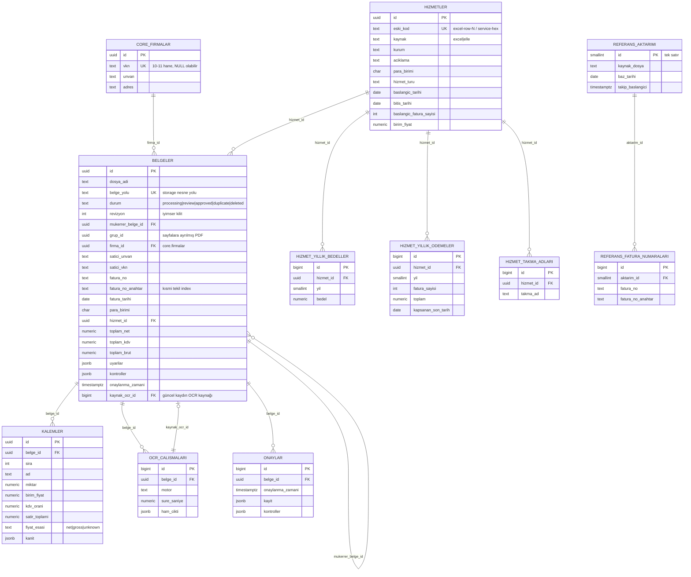

# Veritabanı şeması (Supabase / PostgreSQL)

Fatura OCR Sistemi'nin Supabase'e (self-hosted, Coolify) taşınması için hazırlanan şema. Aynı Supabase instance'ı ileride başka projeleri de (ör. THDX Dijital Hizmetler Platformu) barındıracağı için veri iki katmana ayrılır:

- **`core`**: Projeler arası ortak veri ve yardımcılar.
- **`fatura`**: Yalnızca bu projenin tabloları.

| Dosya | İçerik |
| --- | --- |
| [`supabase/migrations/20261123090000_core.sql`](../supabase/migrations/20261123090000_core.sql) | `core` şeması, `core.firmalar`, `core.updated_at_ayarla()` |
| [`supabase/migrations/20261123090100_fatura.sql`](../supabase/migrations/20261123090100_fatura.sql) | `fatura` şeması, tablolar, index'ler, görünümler, `fatura_backend` rolü, GRANT, RLS, Storage bucket |
| [`supabase/rollback/`](../supabase/rollback/) | Her migration için elle çalıştırılan geri alma betiği |
| [`veritabani-tasima-plani.md`](veritabani-tasima-plani.md) | Mevcut SQLite ve JSON verisinin taşınma planı |

> Migration'lar henüz hiçbir veritabanında çalıştırılmadı.

## Mimari kurallar

- `core` hiçbir proje şemasına referans vermez. Proje şemaları yalnızca `core`'a referans verir, birbirine vermez.
- Son kullanıcı, login veya profil yok. `auth.users`'a bağlı tablo, alan veya RLS kuralı yok.
- Veriye yalnızca backend erişir: `fatura_backend` Postgres rolü.
  - `anon`, `authenticated` ve `service_role` rollerine fatura tablolarında yetki verilmez.
  - RLS tüm tablolarda açık; politikalar yalnızca `fatura_backend` için yazıldı.
- `core` ve `fatura` şemaları PostgREST'e (`PGRST_DB_SCHEMAS`) açılmaz. Backend, Supavisor üzerinden doğrudan Postgres'e bağlanır.
- Belgeler private `fatura-belgeler` bucket'ında tutulur; tabloda yalnızca nesne yolu (`belge_yolu`) durur.
- **Yeni bir proje eklemek:**
  1. Yeni bir migration dosyası eklenir, örneğin `YYYYMMDDHHMMSS_thdx.sql`.
  2. Bu dosya kendi şemasını ve rolünü oluşturur.
  3. `core` tablolarına kendi rolü için GRANT ve RLS politikasını kendisi ekler.

  Mevcut migration'lara dokunulmaz.
- Para alanları `numeric(18,2)`; birim fiyat ve miktar `numeric(18,4)`; KDV oranı `numeric(5,2)`. Tarihler `date`, zamanlar `timestamptz`.
- Her tabloda `created_at` ve `updated_at` var; `updated_at`, `core.updated_at_ayarla()` tetikleyicisiyle güncellenir.

## ER diyagramı



Görünümler: `fatura.hizmet_zam_oranlari` ve `fatura.hizmet_toplam_artis` (aşağıda).

## Durum akışı

Koddaki değerler aynen korunur (`fatura.belgeler.durum`):

```
yükleme ─► processing ─(OCR biter veya hata verir)─► review ─(onay)─► approved
               │                                       ▲   │
               │                                       └───┘ yeniden analiz (retry)
               └─(aynı fatura no aktif bir kayıtta)─► duplicate
herhangi biri (processing hariç) ─► deleted   (yumuşak silme)
```

- OCR hatasının ayrı bir durumu yok. Kayıt `review`'a geçer ve `hata_mesaji` doldurulur ([app.py:221-233](../fatura/web/app.py#L221-L233)).
- Uygulama kapanırken `processing`'de kalan kayıtlar açılışta `review`'a çekilir ([storage.py:64-67](../fatura/storage.py#L64-L67)).
- Geçişler: [storage.py:179-261](../fatura/storage.py#L179-L261).

## Tablolar

### `core.firmalar`

**Amaç:** Projeler arası ortak tedarikçi kartı.

**Neden `core`'da:** THDX gibi başka projeler de tedarikçi firmayı kullanacak; proje şemaları birbirine referans veremediği için ortak kart `core`'da tutulur.

**Koddan gelen:** Faturadaki satıcı bilgisi (`seller.name`, `tax_id`, `address`); kaynaklar [schema.json:29-57](../fatura/schema.json#L29-L57) ve [app.py:64-67](../fatura/web/app.py#L64-L67).
- Kodda ayrı bir firma kartı yok. Kart, faturada VKN okunduğunda backend tarafından oluşturulup eşleştirilecek; **bu yeni bir davranış, onaylandı**.
- Kodda karşılığı olmayan alanlar (vergi dairesi, aktiflik) eklenmedi.

### `fatura.belgeler`

**Amaç:** Yüklenen her belge ve kullanıcının düzelttiği güncel fatura başlığı.

**SQLite karşılığı:** `documents` tablosu ve `edited_json` içindeki başlık alanları ([storage.py:36-62](../fatura/storage.py#L36-L62)).

| Alan | Koddaki kaynak |
| --- | --- |
| `id` | `documents.id`. 32 haneli hex uuid ([app.py:182](../fatura/web/app.py#L182), [app.py:288](../fatura/web/app.py#L288)); `uuid` tipine birebir dönüşür. |
| `dosya_adi`, `mime_turu` | `filename` (en fazla 180 karakter, [app.py:179](../fatura/web/app.py#L179)), `mime` |
| `belge_yolu` | Yeni. Diskteki `data/files/{id}/source` yerine bucket'taki `{yil}/{ay}/{id}.pdf` ([storage.py:263-265](../fatura/storage.py#L263-L265)) |
| `durum`, `revizyon`, `hata_mesaji` | `status`, `revision` (iyimser kilit, [storage.py:205-237](../fatura/storage.py#L205-L237)), `error` |
| `mukerrer_belge_id` | `duplicate_of` ([storage.py:179-203](../fatura/storage.py#L179-L203)) |
| `grup_id`, `grup_sayfa`, `grup_sayfa_sayisi` | `batch_id`, `batch_page`, `batch_count`: her sayfası ayrı fatura olan PDF ([app.py:190-219](../fatura/web/app.py#L190-L219), [storage.py:110-142](../fatura/storage.py#L110-L142)) |
| `satici_unvan`, `satici_vkn`, `satici_adres` | `seller.name`, `seller.tax_id`, `seller.address`; okunduğu hâliyle saklanır |
| `firma_id` | Yeni, boş bırakılabilir. VKN eşleşirse `core.firmalar`'a bağlanır. |
| `fatura_no`, `fatura_tarihi`, `para_birimi`, `fatura_notu` | `invoice_number`, `invoice_date`, `currency`, `invoice_note` ([app.py:68-75](../fatura/web/app.py#L68-L75)) |
| `fatura_no_anahtar` | `storage.invoice_key()`: NFKC normalizasyonu, büyük harf, boşluksuz ([storage.py:11-13](../fatura/storage.py#L11-L13)). Backend hesaplar. |
| `hizmet_id` | `service_id`: elle seçilir ya da kayıtta otomatik eşleşir ([app.py:476-478](../fatura/web/app.py#L476-L478)) |
| `toplam_*`, `odenecek_tutar` | `totals.net`, `vat`, `gross`, `discount`, `withholding`, `payable` ([app.py:79-82](../fatura/web/app.py#L79-L82)) |
| `inceleme_gerekli`, `uyarilar`, `kontroller` | `needs_review`, `issues`, `checks` |
| `onaylanma_zamani` | `approved_at` |
| `kaynak_ocr_id` | Güncel kaydın kanıt kutuları, OCR sayfa metni ve ölçümlerinin alındığı OCR çalıştırması. Yeniden analizden sonra son çalıştırma, kullanıcı kaydından sonra ilk okuma olur ([storage.py:179-203](../fatura/storage.py#L179-L203), [app.py:33-37](../fatura/web/app.py#L33-L37)). Boşsa belge henüz okunmamıştır. |

**Kısıtlar:**
- `belgeler_mukerrer`: `duplicate` kayıtta `mukerrer_belge_id` dolu, aktif kayıtta boş olmalı. Silinen kayıt bu bilgiyi korur; SQLite da silmede `duplicate_of`'u temizlemiyor ([storage.py:250-261](../fatura/storage.py#L250-L261)).
- `belgeler_onay_zorunlu`: `approved` durumundaki kayıtta fatura no, tarih, para birimi, satıcı unvanı ve üç toplam dolu olmalı. Bu, [approval_errors (app.py:127-158)](../fatura/web/app.py#L127-L158) kuralının başlık kısmıdır.
- Kalem zorunlulukları uygulamada kalır, çünkü bunu tek satırlık bir check kısıtıyla ifade etmek mümkün değil.

**Index'ler:**
- `belgeler_fatura_no_tekil`: Mükerrer kontrolü. Fatura numarası **satıcıdan bağımsız** olarak `processing`, `review` ve `approved` kayıtlar arasında tekil olmalı ([storage.py:164-177](../fatura/storage.py#L164-L177)).
- `belgeler_liste`: Liste ekranı `created_at` azalan sıralar; silinmiş ve mükerrer kayıtlar listede görünmez ([storage.py:155-162](../fatura/storage.py#L155-L162)).
- `belgeler_analiz`: Analiz ekranı yalnızca onaylı kayıtları para birimi ve fatura tarihine göre toplar ([analytics.py:6](../fatura/analysis/analytics.py#L6)).
- `belgeler_tarih`: Liste filtresindeki tarih aralığı ([app.js:1272-1289](../fatura/web/static/app.js#L1272-L1289)).

### `fatura.kalemler`

**Amaç:** Fatura kalemleri (`edited_json.items`, [app.py:83-116](../fatura/web/app.py#L83-L116)).

- `ad`, `aciklama`, `birim`, `miktar`, `birim_fiyat`, `kdv_orani`, `satir_toplami` ve `iskonto` alanları `name`, `description`, `unit`, `quantity`, `unit_price`, `vat_rate`, `line_total` ve `discount` alanlarından gelir.
- `fiyat_esasi` ve `toplam_esasi`, `price_basis` ve `total_basis` alanlarıdır (`net` / `gross` / `unknown`).
- Kısıtlar koddaki doğrulamayla aynı: miktar 0'dan büyük, KDV oranı 0–100 arası ([app.py:106-115](../fatura/web/app.py#L106-L115)).
- **`kanit`:** OCR'ın kalemi belgede bulduğu konum (`evidence`). İnceleme ekranı bunu kullanır. Kullanıcı kalemi düzenleyip kaydettiğinde boşalır ([app.py:91-93](../fatura/web/app.py#L91-L93)); ilk OCR kanıtı her zaman `ocr_calismalari.ham_cikti` içinde de durur.

### `fatura.ocr_calismalari`

**Amaç:** Her OCR çalıştırmasının ham çıktısı; ilk okuma ve yeniden analizler.

- **SQLite karşılığı:** `analyses` tablosu ([storage.py:179-187](../fatura/storage.py#L179-L187)).
- **İlk okuma:** SQLite'taki `original_json` ayrı tutulmaz; belgenin en eski çalıştırması ilk okumadır (`original_json = COALESCE(original_json, ilk analiz)`).
- **`ham_cikti`:** Kaydın tamamı (`evidence`, `pages`, `checks`, `issues`, `metrics`, `schema_version`, `source`; [schema.json](../fatura/schema.json)).
- **`motor`:** `record.reader` ([worker.py:39](../fatura/ocr/worker.py#L39)).
- **`sure_saniye`:** `metrics.elapsed_seconds`.
- Yalnızca eklenir ve okunur; `fatura_backend`'in UPDATE ve DELETE yetkisi yok.
- **`belge_id` FK'si ertelenebilir** (`deferrable initially immediate`). Uygulama ertelemez. Veri taşıması, belgeyi `kaynak_ocr_id`'siyle tek INSERT'te yazabilmek için bu kısıtı transaction sonuna erteler; yoksa sonradan yapılan UPDATE, tetikleyici yüzünden özgün `updated_at`'i ezerdi.

### `fatura.onaylar`

**Amaç:** Her onayın anlık kopyası; denetim izi.

- **SQLite karşılığı:** `approvals` tablosu ([storage.py:232-236](../fatura/storage.py#L232-L236)).
- Yalnızca eklenir ve okunur.

### `fatura.hizmetler`

**Amaç:** Zam analizinde izlenen hizmetler.

**Kaynak:**
- `increase-analysis.json` içindeki `rows` (Excel aktarımı).
- `service-tracking.json` içindeki `custom_rows` (elle eklenen) ve `overrides` (düzeltmeler).
- İlgili kod: [services.py:41-55](../fatura/analysis/services.py#L41-L55).

**Alanlar:**
- **`eski_kod`:** SQLite dönemindeki kimlik (`excel-row-N` / `service-<hex>`). Taşımada eşleme ve eski adresler için tutulur.
- **`kaynak`:** Excel satırı mı, elle eklenmiş mi. Kod bu ayrımı kimlik önekine bakarak yapıyor ([services.py:348-349](../fatura/analysis/services.py#L348-L349)).
- **`kurum`:** Serbest metin; şimdilik `core.firmalar`'a bağlı değil. Uzunluk sınırları [services.py:74-87](../fatura/analysis/services.py#L74-L87) ile aynı.
- **`baslangic_elle` / `bitis_elle`:** Kodda `start_date` ve `end_date` anahtarlarının **varlığı** anlam taşıyor.
  - Anahtar varsa ve boşsa "dönem yok" demektir.
  - Anahtar yoksa dönem nottan çıkarılır ([services.py:96-106](../fatura/analysis/services.py#L96-L106), [services.py:405-414](../fatura/analysis/services.py#L405-L414)).
  - NULL bu iki durumu ayırt edemediği için her tarih için bir bayrak eklendi.
- **`baslangic_fatura_sayisi`:** `invoice_count`, yani Excel başlangıcındaki fatura sayısı. Ekranda bu sayıya yeni faturalar eklenir ([services.py:372-375](../fatura/analysis/services.py#L372-L375)).

### `fatura.hizmet_yillik_bedeller`

**Amaç:** Hizmetin yıllara göre başlangıç bedeli (`amounts`).

- Bedel NULL olabilir; kodda yıl anahtarı var ama değeri boş olabiliyor ([services.py:124-129](../fatura/analysis/services.py#L124-L129)).
- Zam oranları bu tablodan görünümle hesaplanır.

### `fatura.hizmet_yillik_odemeler`

**Amaç:** Geçmiş yıllar için elle girilen yıllık ödeme toplamları (`yearly_payments`; [services.py:131-163](../fatura/analysis/services.py#L131-L163)).
- `kapsanan_son_tarih`'e kadarki PDF faturalar toplama tekrar eklenmez ([services.py:440-495](../fatura/analysis/services.py#L440-L495)).
- Kapsanan tarih ödeme yılı içinde olmalı; bu kural bir check kısıtı olarak da eklendi.

### `fatura.hizmet_takma_adlari`

**Amaç:** Fatura–hizmet eşleştirmesinde hizmet adına ek olarak aranan adlar (`aliases`). Kaynak: `service-tracking.json` → `aliases` ([services.py](../fatura/analysis/services.py), `rows`, `add_alias`, `clean_aliases`).

Takma ad üç yoldan gelir:
- **Hizmet düzenleme penceresi:** "Takma adlar" alanına her satıra bir ad yazılır.
- **Fatura incelemesi:** Kullanıcı hizmeti elle seçtiğinde (otomatik eşleşme yoksa veya farklıysa), faturanın kalem açıklaması takma ad olarak önerilir. Seçenek varsayılan olarak işaretlidir ve metin düzenlenebilir. Fatura kaydedilince eklenir; aynı açıklamalı sonraki faturalar otomatik eşleşir.
- **Eski sabit liste:** Eskiden kodda sabit duran PACS (`Radyoloji Görüntüleme`, `PACS`) ve Protein TSS (`TSS Protein`) takma adları, uygulama ilk açıldığında bir kez veriye taşınır (`migrate_aliases`). Sonrasında diğerleri gibi düzenlenir ve silinir.

Kurallar: Bir hizmete en fazla 100 takma ad eklenebilir; her biri en fazla 300 karakter olur. Yazım farkı dışında aynı olan adlar ve hizmet adının kendisi tekrar eklenmez (`services.words` normalizasyonu).

### `fatura.referans_aktarimi` ve `fatura.referans_fatura_numaralari`

**Amaç:** Excel aktarımının bilgisi ve zaten Excel'de sayılmış fatura numaraları.

- **`baz_tarihi`:** `baseline_as_of`. Bu tarihe kadarki PDF'ler Excel bedelini ezmez ([services.py:311-316](../fatura/analysis/services.py#L311-L316), [services.py:387-389](../fatura/analysis/services.py#L387-L389)).
- **`takip_baslangici`:** `service-tracking.json` içindeki `started_at`. Bundan önce yüklenen belgeler, elle hizmet seçilmediyse analize alınmaz ([services.py:323-326](../fatura/analysis/services.py#L323-L326)).
- **`referans_fatura_numaralari.fatura_no_anahtar`:** `services.words()` ile normalize edilmiş numara. Bu, `invoice_key`'den farklı bir normalizasyon ([services.py:20-21](../fatura/analysis/services.py#L20-L21)).

### Görünümler

| Görünüm | Hesap | Kod |
| --- | --- | --- |
| `fatura.hizmet_zam_oranlari` | `(bu yıl − önceki yıl) / önceki yıl`, 4 ondalık (`rates`) | [services.py:164-167](../fatura/analysis/services.py#L164-L167), [services.py:498-507](../fatura/analysis/services.py#L498-L507) |
| `fatura.hizmet_toplam_artis` | İlk ve son bedelli yıl arasındaki artış (`total_increase`) | [services.py:168-171](../fatura/analysis/services.py#L168-L171) |

- İki görünüm de `security_invoker = true`; dolayısıyla RLS ve GRANT'ler çağıranın yetkisiyle uygulanır.
- **Sınır:** Görünümler yalnızca başlangıç bedellerini kullanır. Onaylı yeni faturaların yıllık bedele yansıtılması uygulama mantığında kalır ([services.py:379-402](../fatura/analysis/services.py#L379-L402)).

## Yetkiler ve RLS özeti

| Rol | `core.firmalar` | `fatura.belgeler` | `kalemler`, `hizmet_yillik_*`, `takma_adlari` | `ocr_calismalari`, `onaylar`, `referans_fatura_numaralari` | Diğer `fatura` tabloları |
| --- | --- | --- | --- | --- | --- |
| `fatura_backend` | SELECT, INSERT, UPDATE | SELECT, INSERT, UPDATE (yumuşak silme) | Tam | SELECT, INSERT | SELECT, INSERT, UPDATE |
| `anon`, `authenticated` | — | — | — | — | — |
| `service_role` | — | — | — | — | — |

Storage: `fatura-belgeler` bucket'ı private, en fazla 25 MB, yalnızca `application/pdf` ([app.py:29](../fatura/web/app.py#L29), [app.py:177](../fatura/web/app.py#L177)). Backend Storage API'yi `SUPABASE_SERVICE_ROLE_KEY` ile kullanır; bu anahtar yalnızca sunucuda, ortam değişkeninde durur.

## Uygulamanın Supabase modu

Uygulama, `FATURA_DATABASE_URL` tanımlıysa SQLite ve JSON yerine Postgres ile Storage'ı kullanır; tanımlı değilse eskisi gibi çalışır. Kod [`fatura/supabase/`](../fatura/supabase/) altında:

| Modül | Görevi |
| --- | --- |
| [`store.py`](../fatura/supabase/store.py) | `PgStore`: `fatura.storage.Store` ile aynı arayüz. Belge, kalem, OCR çalıştırması ve onay kayıtlarını yönetir. |
| [`services.py`](../fatura/supabase/services.py) | `PgServices`: Hizmet ve zam verisi. Eşleştirme ve analiz mantığı ortak `Services` sınıfından gelir. |
| [`columns.py`](../fatura/supabase/columns.py) | Kayıt alanlarını tablo kolonlarına çevirir ve hassasiyet sınırlarını denetler. |
| [`files.py`](../fatura/supabase/files.py) | Storage istemcisi: yükleme (üzerine yazmadan), indirme ve silme. |
| [`migrate.py`](../fatura/supabase/migrate.py) | Mevcut SQLite ve JSON verisinin taşınması (bkz. [taşıma planı](veritabani-tasima-plani.md)). |

Uygulamanın davranışı:
- **Kimlikler:** Uygulamaya eskisi gibi 32 haneli hex olarak verilir, veritabanında `uuid` olarak saklanır.
- **PDF'ler:** Yükleme sırasında bucket'a gider. OCR ve önizleme için yerel önbelleğe (`FATURA_DATA_DIR/files/{id}/source`) indirilir; önbellek silinse de belge kaybolmaz.
- **Hassasiyet:** Tutar ve miktar alanlarında kolon hassasiyetini aşan değer **sessizce yuvarlanmaz**.
  - Kullanıcı kaydında anlaşılır bir hatayla reddedilir.
  - OCR çıktısında alan boş bırakılır ve `storage_precision` uyarısı eklenir.
- **Mükerrer kontrolü:** SQLite'taki `BEGIN IMMEDIATE` kilidinin yerini işlem içi bir advisory lock alır; unique index ek güvencedir.
- **Liste:** `list()` hafiftir; liste ve analiz ekranları için kanıt kutuları ve OCR sayfa metni yüklenmez.

**Testler:** Testler PostgreSQL ister; sunucu yoksa atlanır.

```sh
FATURA_TEST_PG_ADMIN_URL=postgresql://postgres:<parola>@127.0.0.1:55432/postgres \
  python -m unittest discover -s tests
```

- Her çalıştırmada geçici bir veritabanı açılır. Önce [`supabase/tests/supabase_stub.sql`](../supabase/tests/supabase_stub.sql) (Supabase rollerinin ve `storage.buckets`'ın yerel taklidi), ardından migration'lar uygulanır.
- Testler `fatura_backend` rolüyle çalışır; böylece yetkilerin yeterliliği de sınanmış olur.
- `test_supabase_backend.py`, aynı işlem sırasını SQLite ve Postgres depolarında çalıştırıp sonuçları karşılaştırır. Taşıma betiği de burada sınanır: her belge durumu, prova ve geri alma, çakışmalar, dışlama ve yarım kalmış yükleme.

## Migration sonrası (SQL dışında)

1. Rol girişi ve parolası. Parola Coolify secret'ında tutulur:

   ```sql
   alter role fatura_backend with login password '<FATURA_DB_PASSWORD>';
   ```
2. Backend bağlantı adresi:

   ```
   FATURA_DATABASE_URL=postgresql://fatura_backend.dev_tenant:<FATURA_DB_PASSWORD>@<SUPAVISOR_HOST>:6543/postgres
   ```

   Kurulu Supavisor tenant adı `dev_tenant`; Coolify Supabase şablonunun varsayılanı korundu. Self-hosted kurulumda bu değer `POOLER_TENANT_ID` ortam değişkenidir ve kullanıcı adındaki `.` işaretinden sonraki kısımla birebir (büyük/küçük harf dahil) eşleşmelidir.
3. `PGRST_DB_SCHEMAS` değişkenine `fatura` ve `core` **eklenmez**.
4. Backend'e `SUPABASE_URL` ve `SUPABASE_SERVICE_ROLE_KEY` ortam değişkenleri tanımlanır.

## Açık sorular

1. ~~Sabit takma adlar~~: **Karar verildi.** Takma adlar veriye taşındı ve kullanıcı tarafından eklenebilir hâle geldi (bkz. `fatura.hizmet_takma_adlari`).
2. **Normalizasyon farkı:** `fatura_no_anahtar` Python'da hesaplanıyor (`unicodedata` NFKC + `str.upper`). Postgres'te `upper()` Türkçe `ı`/`i` gibi harflerde yerel ayara göre farklı sonuç verebileceği için anahtarı veritabanı hesaplamıyor. Anahtarın her zaman backend'den gelmesi uygun mu?
3. **Yuvarlama farkı:** `services.ratio` Decimal `quantize` kullanıyor (yarımda çifte yuvarlar). Postgres `round()` ise yarımda sıfırdan uzağa yuvarlar. Fark yalnızca tam 0,00005 sınırında oluşur; kabul edilebilir mi?
4. ~~Supavisor tenant adı~~: **Kurulumdaki değer:** `dev_tenant`. Önce `Fatura_Sistemi` planlanmıştı; mevcut instance'a dokunmamak için varsayılan korundu.
   - Self-hosted Supabase'de Supavisor tenant'ı proje başına değil, **instance başına** tektir. THDX de aynı instance'a eklendiğinde `thdx_backend.dev_tenant` kullanıcı adıyla bağlanacak.
   - Projeler arasındaki ayrım tenant ile değil, Postgres rolleriyle (`fatura_backend`, `thdx_backend`) yapılır.
   - Tenant adı sonradan değiştirilirse tüm projelerin bağlantı adresleri değişir.
5. **Storage sürümü:** `storage.buckets` tablosundaki `file_size_limit` ve `allowed_mime_types` kolonları storage-api'nin güncel sürümlerinde var. Kurulu sürüm eskiyse bu iki kolon migration'dan çıkarılmalı.
6. ~~Uygulama kodu~~: **Yapıldı.** Postgres ve Storage arka ucu eklendi (bkz. "Uygulamanın Supabase modu"). Gerçek Supabase'e bağlanmak için migration'ların uygulanması ve ortam değişkenlerinin tanımlanması gerekiyor.
